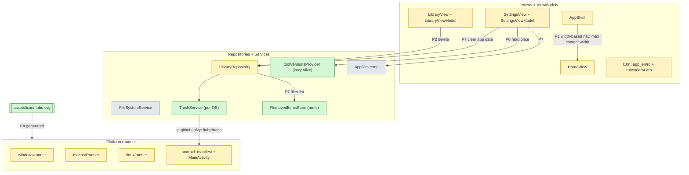
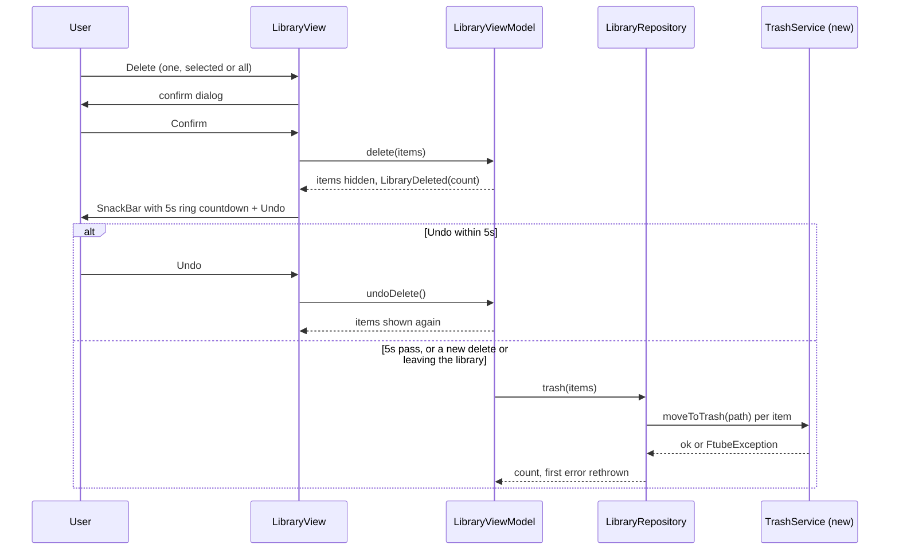
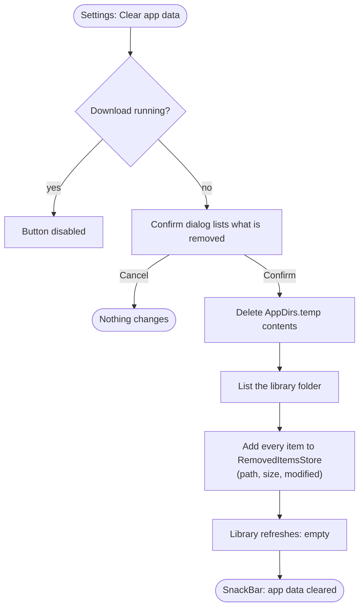
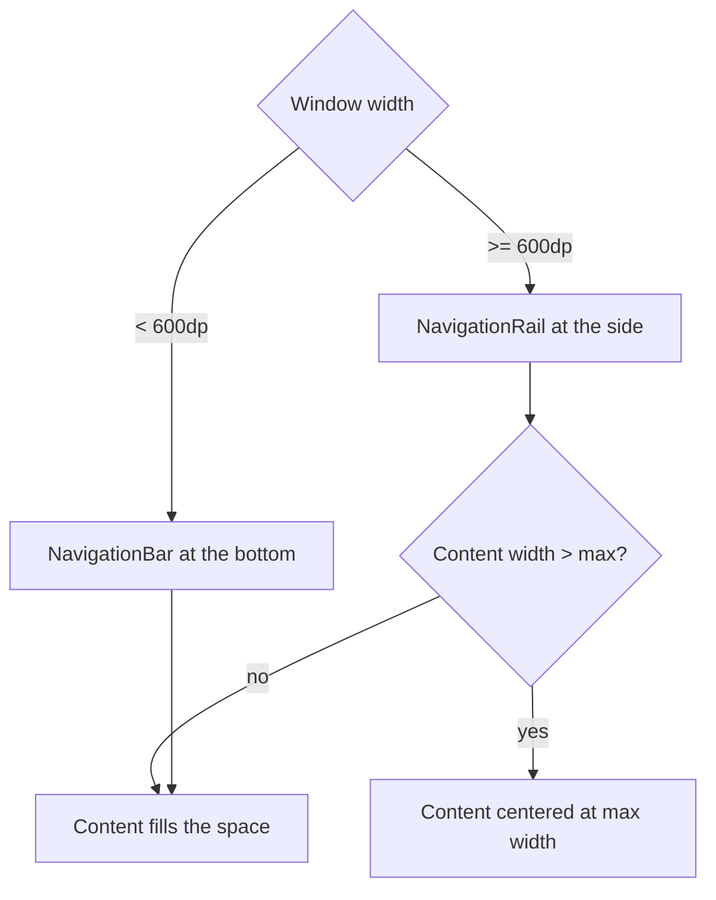
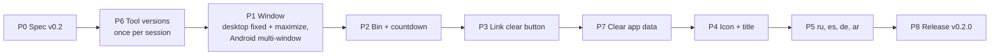

# Ftube Downloader v0.2 - Specification

Builds on [spec.md](spec.md) (v0.1). Decision, DoD and risk IDs continue that document's numbering.

## Summary

- v0.2.0 is a UX release. Nothing changes in how media is downloaded or converted.
- **Library:**
  - Delete moves files to the system bin instead of removing them.
  - After the confirm dialog, a Telegram-style 5s countdown sits next to Undo.
  - A new Settings action, "Clear app data", empties the cache. It also removes every current item from the library for good, while the files stay on disk.
- **Window:**
  - On desktop the window opens at 800×600. Edge-drag resize is off, but maximize still works and the layout adapts to it.
  - Android supports landscape, split screen, multi-window and pop-up windows.
- **Smaller changes:**
  - Tool versions are checked once per session instead of on every visit to Settings.
  - The link field gets a clear button.
  - The app gets a new icon and the title "Ftube Downloader".
  - Russian, Spanish, German and Arabic are added. Arabic is right-to-left.
- **Main risks:**
  - Android's bin API may show its own system dialog as well.
  - GTK may not allow maximize while resize is off.
  - Removing items from the library can't be undone.

## 1. What changes

**Which parts of the app each phase touches**

## 2. Main flows

**Delete: confirm, countdown, bin**

- The countdown ring and the seconds both come from the same `LibraryViewModel.undoWindow` (5s), so the SnackBar closes exactly when the files go to the bin.
- Undo only cancels the hide. Once files are in the bin, the user restores them there with the OS.

**Clear app data**

- Settings and the desktop binaries are not touched.
- Removed items never come back, even if a "show hidden" view is added later. A file is matched by path, size and modified time, so a new download with the same name still shows.

## 3. Window behaviour

**Navigation and width by window size**

- Desktop: the window opens at 800×600 on every OS. Edge-drag resize is off and maximize is on.
- Android: no orientation lock, `resizeableActivity="true"`. Every screen scrolls instead of overflowing at small heights (landscape phone, 1/3 split, pop-up window).

## 4. Decisions

- D-19: Tool versions (yt-dlp, ffmpeg) are read by a `@Riverpod(keepAlive: true)` `toolVersionsProvider` - Settings is auto-dispose, so it re-ran the version commands on every visit. `updateYtDlp()` invalidates it after a successful update.
- D-20: The desktop window opens at 800×600 everywhere - macOS already used it, and Windows and Linux used 1280×720. Edge-drag resize is off and maximize stays on:
  - Windows: no `WS_THICKFRAME`, `WS_MAXIMIZEBOX` kept.
  - macOS: content min size = max size = 800×600, full screen allowed.
  - Linux: fixed size through GTK geometry hints, with maximize kept if GTK allows it (R-13).
- D-21: Navigation is chosen by window width (600dp), not by platform - a landscape phone or a maximized desktop gets the rail, and a split-screen half gets the bottom bar. Page content has a maximum width and is centered beyond it.
- D-22: Android declares `android:resizeableActivity="true"` and no orientation lock - the activity already handles configuration changes itself, so only the layout needs work.
- D-23: Delete moves files to the system bin through a `TrashService` - the user can still get files back after the undo window:
  - macOS: `FileManager.trashItem` through a method channel.
  - Windows: `SHFileOperationW` with `FOF_ALLOWUNDO` through a method channel.
  - Linux: `gio trash <path>`.
  - Android: `MediaStore.createTrashRequest` on the `io.github.infvyr.ftube/trash` channel, with a `MediaScannerConnection` scan first so the file has a MediaStore entry.
- D-24: Every delete is confirmed by the app's own dialog first, then hidden for `undoWindow` = 5s with a Telegram-style countdown (a shrinking ring around the seconds left) next to Undo.
- D-25: The link field has a clear (✕) `suffixIcon`, shown only while the field has text. It clears the controller and calls `setUrl('')`.
- D-26: "Clear app data" is one action with no options - it deletes the contents of `AppDirs.temp` and removes every current library item for good. Settings and desktop binaries are kept.
- D-27: Removed library items are stored in prefs by `RemovedItemsStore` as `(path, size, modifiedMs)` - the library has no list of its own (it lists the folder), so this filter is the only way to remove items without deleting files.
- D-28: The app's display name is "Ftube Downloader" in `appTitle`, the Android label, the macOS `CFBundleDisplayName`, the Windows and Linux window titles, `Runner.rc` FileDescription/ProductName and the README. Binary names, bundle and package IDs, method channel names and release file names keep `ftube`/`Ftube` - so updates install over v0.1 and the release workflow paths don't change.
- D-29: The icon is a rounded square with a gradient, a play triangle and a download arrow, drawn once as `assets/icon/ftube.svg`. `flutter_launcher_icons` (dev dependency) generates the Android adaptive and monochrome, macOS, Windows `.ico` and Linux icons from it.
- D-30: New languages are Russian, Spanish, German and Arabic (`app_ru/es/de/ar.arb`, `AppLanguage.ru/es/de/ar`). Arabic is right-to-left: layouts use directional padding and alignment (`EdgeInsetsDirectional`, `AlignmentDirectional`) only.

## 5. Testing

| Level | Covers | Tools |
|---|---|---|
| ViewModel | Opening Settings twice runs the version commands once, and again after `updateYtDlp()` | `ProviderContainer`, fake `BinaryService` |
| ViewModel | Delete hides items, Undo restores them, 5s commits to the bin, a second delete commits the first | fake `TrashService`, `fakeAsync` |
| Unit | `LibraryRepository.trash`: every item tried, first error rethrown; the list skips removed items, and a same-name file with a new size or time shows | fakes |
| Unit | `RemovedItemsStore` persists and reloads entries | `SharedPreferences` mock |
| Unit | `TrashService` per OS with the channel or `ProcessRunner` mocked | `TestDefaultBinaryMessenger`, `mocktail` |
| ViewModel | Clear app data empties temp, removes all items, keeps settings, is blocked during a download | `ProviderContainer` |
| Widget | Countdown ring and seconds show next to Undo and the SnackBar closes at 5s | `flutter_test` |
| Widget | Clear button hidden on an empty field, shown with text, clears on tap | `flutter_test` |
| Widget | No overflow and the right navigation at 360×640, 640×360, 360×300 (split), 300×400 (pop-up), 800×600, 1920×1080 | `tester.view.physicalSize` |
| Widget | Every view in Arabic renders right-to-left without overflow | `flutter_test` |
| l10n | Every key in `app_en.arb` exists in all five translations | unit test |
| Manual | Bin on each OS (file shows in the bin and restores); Android split screen, pop-up and rotation; desktop maximize and no edge resize | `docs/release.md` checklist |

## 6. Phases (one clean commit per phase)

- Languages come last so every new string from the earlier phases is translated in one pass.
- P8 bumps `pubspec.yaml` to `0.2.0+2`, updates the README status and adds the manual checks to `docs/release.md`.

**Definition of Done**

- DoD-11: Settings runs the tool version commands once per app launch, and once more after a yt-dlp update.
- DoD-12: The desktop window opens at 800×600, can't be resized from its edges, can be maximized, and has no overflow at either size.
- DoD-13: Android works in portrait, landscape, split screen and pop-up windows with no overflow, and state survives rotation and resizing.
- DoD-14: A confirmed delete shows a 5s countdown with Undo, then the files are in the system bin on every OS.
- DoD-15: The link field shows a clear button only while it has text.
- DoD-16: "Clear app data" empties the cache and the library, never deletes downloaded files or settings, and removed items never come back.
- DoD-17: The new icon shows on all four platforms and the app is titled "Ftube Downloader", while updates still install over v0.1.
- DoD-18: The app is fully translated into EN, RO, RU, ES, DE and AR, and Arabic is right-to-left.
- DoD-19: DoD-3 still holds: analyze and format are clean, all tests pass and the coverage gate is met.

## 7. Constraints and risks

- R-12: Android's `createTrashRequest` returns a `PendingIntent` that may show a system "move to bin?" dialog after the app's own confirm. If so, the user sees two prompts; this is accepted, and it is checked on a device in P2.
- R-13: GTK may not allow maximize on a window that can't be resized. If it doesn't, Linux keeps edge resize with an 800×600 minimum, and the decision is updated.
- R-14: Removing items from the library is permanent. The confirm dialog says so.
- R-15: Machine-assisted translations for RU, ES, DE and AR need a native speaker review before release.
- R-16: `RemovedItemsStore` grows with every clear. Entries whose file no longer exists are pruned when the library is listed.

## 8. Non-goals (v0.2)

- Resetting settings, or deleting the desktop binaries, from "Clear app data".
- Restoring removed library items or a "show hidden" view.
- Emptying or browsing the system bin from the app.
- Changing the package ID, binary names or release file names.
