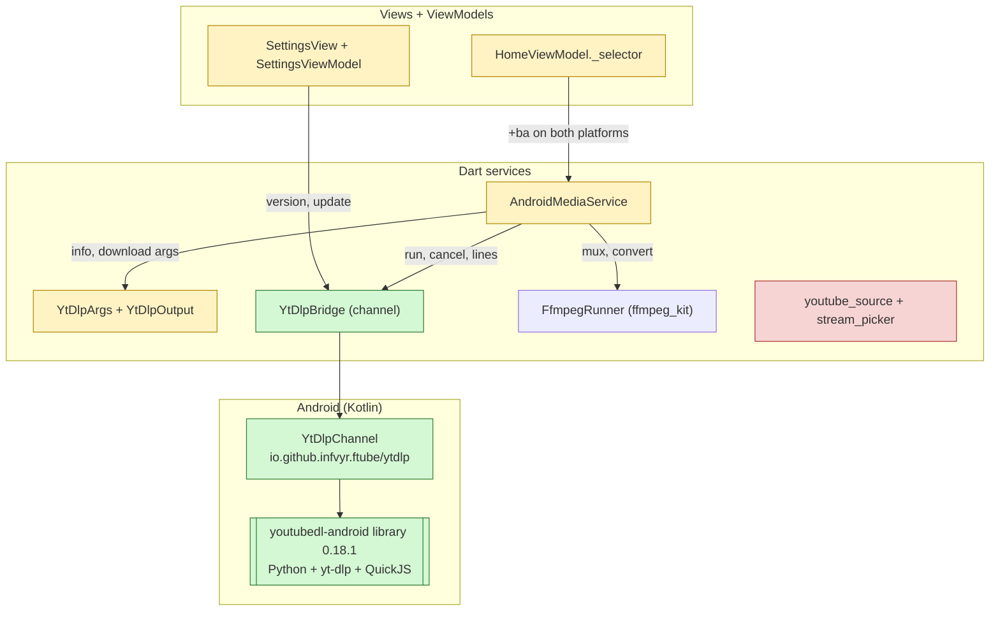
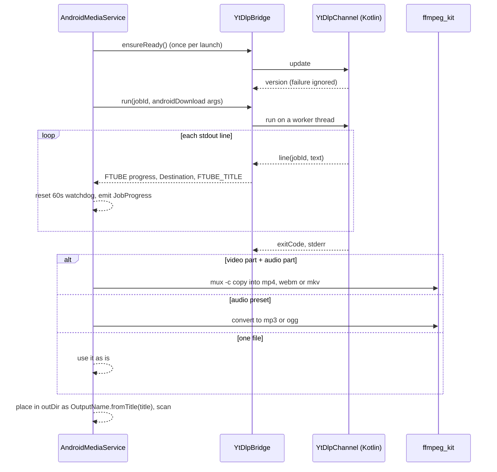
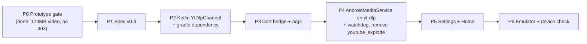

# Ftube Downloader v0.3 - Specification

Builds on [spec.md](spec.md) (v0.1) and [spec-v0.2.md](spec-v0.2.md). Decision, DoD and risk IDs continue their numbering.

## Summary

- **Problem:** on Android, YouTube downloads stop partway and hang with no error.
  - `youtube_explode_dart` 3.1.0 fetches throttled adaptive streams in ~10MB ranges, and YouTube answers 403 after about 20MB.
  - The library then refetches the manifest and retries forever, and drops body errors, so the job freezes (for example at 6%).
  - NewPipe has the same 403 (NewPipe #13824). Desktop is not affected, because it runs yt-dlp.
- **Fix:** Android runs yt-dlp too, through `youtubedl-android`, which bundles Python, yt-dlp and QuickJS.
  - Merging and conversion stay on `ffmpeg_kit`. The library's own ffmpeg module isn't used, because it doesn't load on 16KB-page devices (D-32).
- **Smaller changes:**
  - Android supports every site yt-dlp supports, like desktop.
  - Settings shows the yt-dlp version and an Update button on Android.
  - A stalled yt-dlp run fails after 60s instead of hanging.
- **Main risks:**
  - The yt-dlp bundled with the library is too old for YouTube, so the app must update it from GitHub.
  - The library is GPL-3.0.
  - The APK grows by about 15MB per ABI.

## 1. What changes

**Which parts of the app change**

## 2. Main flows

**Android download**

- yt-dlp sees no working ffmpeg, so for `video+audio` it downloads both formats and leaves them as `media.f<id>.<ext>` in the job temp folder. They are not merged, and the exit code is still 0.
- Each `[download] Destination: <path>` line starts a part. The `vcodec` field of the next `FTUBE|...` line says whether it is the video or the audio.

## 3. Decisions

- D-31: Android downloads with yt-dlp through `io.github.junkfood02.youtubedl-android:library` 0.18.1, which replaces `youtube_explode_dart` (supersedes the download half of D-5).
  - The library ships Python 3, yt-dlp and QuickJS, and runs yt-dlp as a child process.
  - It adds `--js-runtimes quickjs:<path>`, `--ffmpeg-location <path>` and `--no-cache-dir` to every call.
  - Desktop doesn't change.
  - The library ships no R8 rules. `android/app/proguard-rules.pro` keeps `com.yausername`, commons-compress's zip classes (they unpack Python on first launch by reflection) and Jackson (the updater), or the release build fails with "is not a concrete class".
- D-32: The library's `ffmpeg` module is not used.
  - Its shared libraries are 4KB-aligned. On a 16KB-page device (the Android 15 emulator, newer Pixels) ffmpeg fails to link, and yt-dlp reports "ffmpeg is not installed".
  - Dropping it also saves about 36MB per ABI.
  - `ffmpeg_kit`'s libraries are 16KB-aligned, so muxing and conversion keep using `FfmpegRunner`, as in D-5.
- D-33: Kotlin bridge `YtDlpChannel` on the MethodChannel `io.github.infvyr.ftube/ytdlp`:
  - `version` returns the yt-dlp version or null.
  - `update` updates to the latest STABLE yt-dlp release and returns the version.
  - `run {id, args}` returns `{exitCode, stderr}`, and each stdout line is sent back as a Dart-side `line {id, line}` call.
  - `cancel {id}` destroys the process.
  - Calls run on a cached thread pool, with results posted to the main thread.
  - `YoutubeDL.init` runs lazily on the first call; on the first launch it unpacks Python.
  - A non-zero exit returns `exitCode` and `stderr`, not a channel error, so Dart maps it with `YtDlpOutput.mapError` like desktop.
- D-34: `YtDlpArgs.androidInfo` and `YtDlpArgs.androidDownload` reuse `formatSelector` and the progress template, with these differences:
  - No `--ffmpeg-location` or `--js-runtimes` (the library adds them).
  - No `-x` (ffmpeg_kit converts).
  - `-o media.%(ext)s -P <jobTemp>`.
  - `--print video:FTUBE_TITLE|%(title)s` for the output name.
- D-35: The mux container follows yt-dlp's rule. A video `mp4` with `m4a`/`mp4` audio stays `mp4`, a `webm` video with `webm` audio stays `webm`, and anything else is `mkv`. The output is named by D-39.
- D-36: yt-dlp is updated once per app launch, before the first info or download call.
  - The yt-dlp in the 0.18.1 AAR (2025.11.12) already gets 403 from YouTube.
  - If the update fails (offline, GitHub rate limit) the installed version is used.
  - Settings shows the yt-dlp version and the Update button on Android too, reusing D-19's `toolVersionsProvider`.
  - The updated binary lives in `noBackupFilesDir`, which "Clear app data" (D-26) doesn't touch.
- D-37: A yt-dlp run that prints no line for 60s is cancelled and fails with `Network`.
  - yt-dlp prints a progress line about every second while downloading, and extraction steps print a line every few seconds.
  - So 60s of silence means a hang, not a slow network.
- D-38: Android supports any site yt-dlp supports (updates spec.md "Android supports YouTube only").
  - `youtube_source.dart`, `stream_picker.dart` and the `youtube_explode_dart` dependency are removed.
  - `HomeViewModel` adds `+ba` to a video-only custom format on both platforms (extends D-16).
  - The Home empty text and link hint say "video link" instead of "YouTube link" in every language.

- D-39: Downloads keep the video title as the file name, on every platform (`OutputName`).
  - `--restrict-filenames` is dropped, so spaces, case and Unicode stay. Characters that Windows, macOS, Android or FAT forbid (`/ \ : * ? " < > |`) become yt-dlp's look-alikes (`⧸ ⧹ ： ＊ ？ ＂ ＜ ＞ ｜`). Control characters, leading dots and trailing dots or spaces are dropped, Windows device names get a `_`, and names are cut to 200 UTF-8 bytes.
  - Desktop yt-dlp now writes only into the job temp folder as `media.<ext>` and prints `FTUBE_TITLE`. The service then moves the file into the download folder, like Android.
  - A taken name gets ` (2)`, ` (3)`... The name is reserved by creating it exclusively before the move, so an existing file is never replaced and two jobs with one title can't collide.
  - Desktop passes `--encoding utf-8`. Without it yt-dlp on Windows writes the pipe in the ANSI code page and drops the characters it can't encode, so a Cyrillic or Arabic title would be lost.
  - This fixes desktop yt-dlp reusing a same-named file in the download folder: an MP3 after a video of a site without separate audio deleted the video, and a second download in another quality was skipped.

## 4. Testing

| Level | Covers | Tools |
|---|---|---|
| Unit | `androidInfo` / `androidDownload` args per preset: no `-x`, no ffmpeg or JS flags, temp output, title print | `test` |
| Unit | `YtDlpOutput.parseLine` for `Destination` and `FTUBE_TITLE` lines | fixtures |
| Unit | `AndroidMediaService`: info parse; video+audio → mux; audio preset → convert; single file → move; name clash → ` (2)`; non-zero exit → mapped error; cancel; 60s watchdog; update once per launch, failure ignored; temp folder deleted | fake `YtDlpBridge`, fake `FfmpegRunner`, `fakeAsync` |
| Unit | Mux container choice (mp4, webm, mkv) | `test` |
| Unit | `OutputName`: title kept, look-alikes, trimming, byte limit, ` (2)` on clash, parallel jobs | `test` |
| Unit | `DesktopMediaService`: download in temp, placed by title, never replaces a file | fake `ProcessRunner` |
| Unit | `ChannelYtDlpBridge` method calls and `line` callbacks routed by job id | `TestDefaultBinaryMessenger` |
| ViewModel | Android Settings reads the yt-dlp version and updates through the bridge | `ProviderContainer` |
| ViewModel | Custom video-only format gets `+ba` on Android | `ProviderContainer` |
| Manual | Pixel 9a emulator (API 35, 16KB pages) and an Android 12 phone: Big Buck Bunny 1080p downloads in full and merges; MP3 preset; cancel mid-download | `docs/release.md` |

## 5. Phases

**Definition of Done**

- DoD-20: On Android, a 1080p YouTube video larger than 100MB downloads in full and plays with sound, on a 16KB-page emulator and on an Android 12 device.
- DoD-21: MP3 and OGG presets work on Android, and cancel stops yt-dlp and deletes the job's temp folder.
- DoD-22: A stalled download fails within 60s with a network error instead of hanging.
- DoD-23: Android Settings shows the yt-dlp version and updates it.
- DoD-24: DoD-3 still holds: analyze and format are clean, all tests pass and the coverage gate is met.

## 6. Constraints and risks

- R-17: The bundled yt-dlp ages out. Without network on the first launch, YouTube downloads fail until an update succeeds. The error tells the user to update yt-dlp in Settings.
- R-18: `youtubedl-android` and the yt-dlp it runs are GPL-3.0 / Unlicense. Ftube is open source, so the GPL is accepted, and the README lists it.
- R-19: The APK grows by Python (~14MB zipped) and QuickJS (~1MB) per ABI.
- R-20: GitHub's unauthenticated API allows 60 requests an hour per IP, so the update check may be refused. That is treated as a failed update (D-36).
- R-21: YouTube may require PO tokens for more clients later. yt-dlp updates are the mitigation; the watchdog keeps a failure visible.

## 7. Non-goals (v0.3)

- Choosing the yt-dlp update channel (nightly, master).
- Using aria2c or the library's ffmpeg.
- Background downloads with a foreground service.
