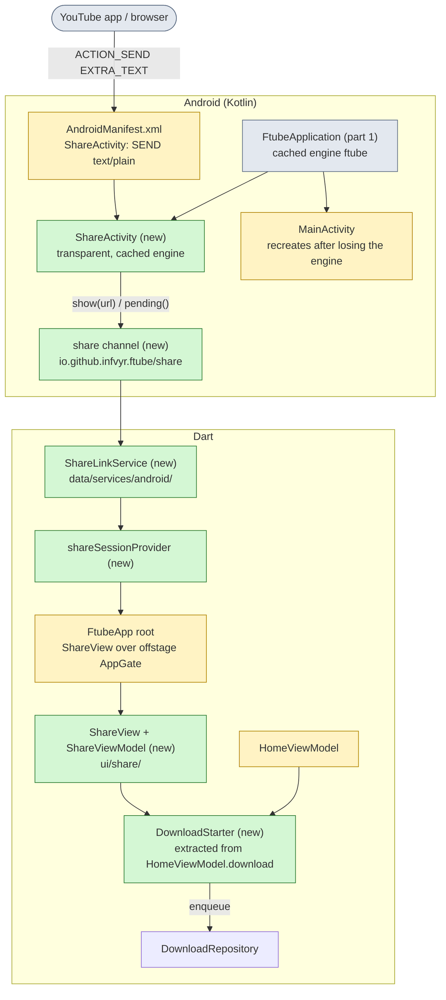
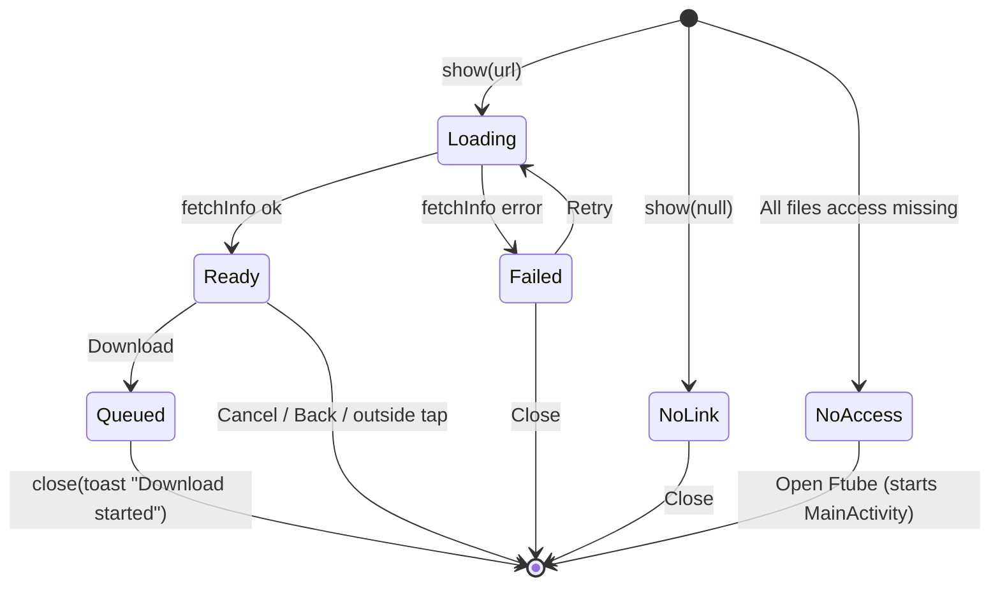
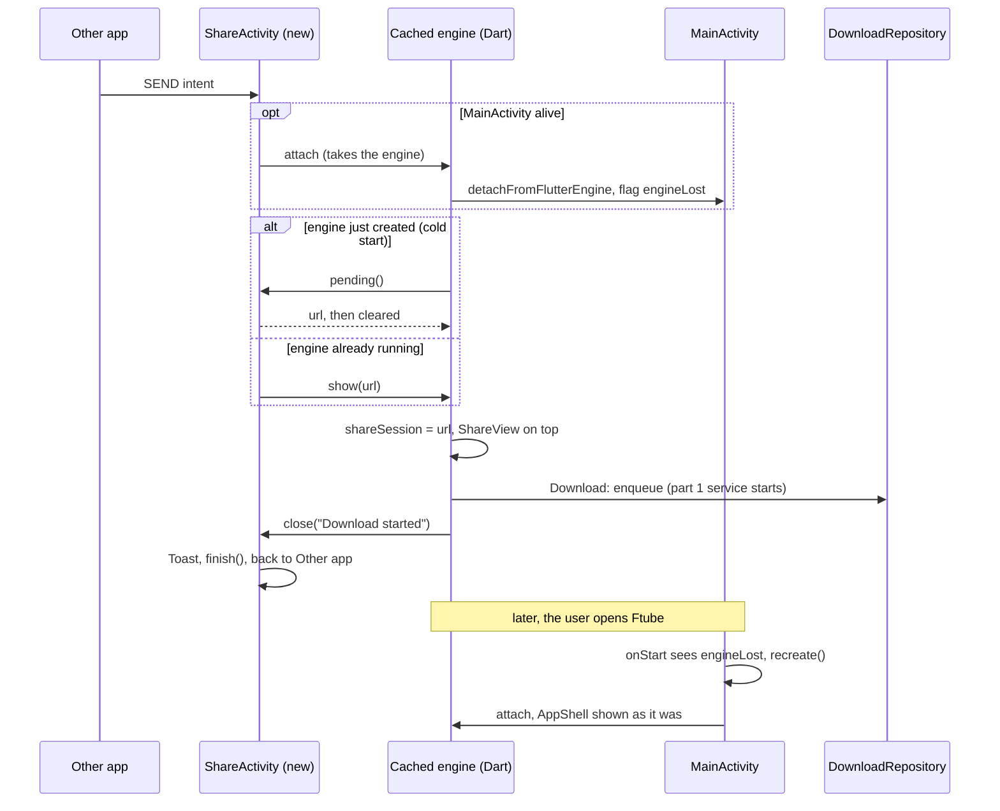
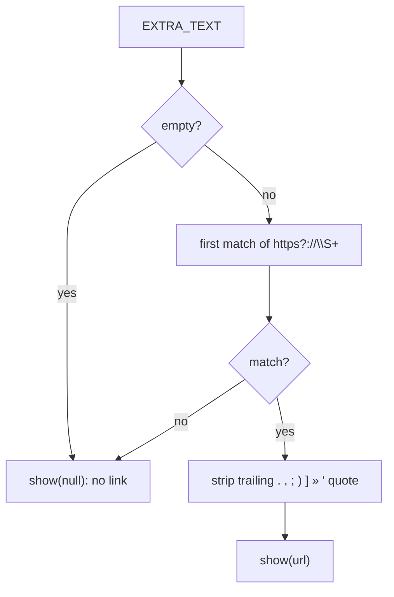

# Ftube Downloader v0.4 - Share popup on Android (part 2 of 2)

Builds on [spec-v0.4.md](spec-v0.4.md) (part 1, background downloads). Decision, DoD and risk IDs continue its numbering. Replaces the earlier v0.3.1 "Share to Ftube" draft, which opened Home instead of a popup.

## Summary

- **What:** on Android, Ftube appears in the system share sheet. Sharing a link from the YouTube app, a browser or any other app opens a small Ftube popup over that app, similar to NewPipe's download dialog. The popup shows the video info, lets the user pick Video or Audio and a format, and Download queues the job and closes the popup. The user stays in the sharing app.
- **Why:** today the user has to copy the link, switch to Ftube, paste it and come back. Ftube has no `SEND` intent filter, only a `PROCESS_TEXT` query added by Flutter.
- **How:**
  - A new `ShareActivity` receives `ACTION_SEND` / `text/plain`. It is a see-through `FlutterActivity` on the cached `ftube` engine from part 1 (D-41), so the popup and the app share one Dart queue.
  - A new `io.github.infvyr.ftube/share` channel hands the link to Dart. The Dart root shows `ShareView` on top and keeps the app's widget tree offstage underneath, so its state is kept.
  - `ShareViewModel` has its own state, so Home is left alone. The enqueue path is moved out of `HomeViewModel.download` into a shared `DownloadStarter`.
  - After the popup closes, part 1's foreground service keeps the download alive.
- **Unchanged:** desktop, the queue, Home, and the rule that nothing downloads until the user taps Download.
- **Main risk:** the engine can be attached to only one activity at a time. Opening the popup takes it from a running `MainActivity`, which has to get it back when the user returns to Ftube (R-26). This needs a device spike before the rest is built.

## 1. What changes

**Which parts change**



## 2. Popup

**What the popup looks like**

```text
 ┌──────────────────────────────────────────┐
 │ [thumb]  Video title, two lines at most  │
 │          Uploader · 12:34                │
 │                                          │
 │  ( Video )  ( Audio )                    │
 │  [Best] [1080p] [720p] [480p]            │  Audio tab: [MP3] [OGG]
 │  Format: Best available            ▼     │  menu of all formats with sizes
 │                                          │
 │                     [Cancel] [Download]  │
 └──────────────────────────────────────────┘
```

- The Video and Audio tabs split today's `homePresets`: `best`, `p1080`, `p720`, `p480` under Video and `audioMp3`, `audioOgg` under Audio.
- The Format menu lists the formats from `MediaInfo.formats` for the current tab, with resolution, container and size. Picking one selects `QualityPreset.custom`, the way Home's "All formats" sheet does.
- The popup opens on the tab and preset of Settings' `defaultPreset`.
- While loading, the popup shows the link and a spinner. On an error it shows the message from `l10n.errorMessage` with Retry and Close.
- Tapping outside the popup, Back and Cancel all close it without downloading.

**Popup states**



## 3. Flows

**A share with Ftube running in the background, and a cold start**



- Pull plus push, so a cold-start link isn't lost before Dart has registered its handler. `pending()` returns the link only once.
- A second share while the popup is open replaces its link (`onNewIntent` -> `show(url)`).
- `shareSession` is cleared when `ShareActivity` is destroyed, even without `close` (for example when the system kills it), through `dismissed` from Kotlin.

**How a link is pulled out of the shared text**



- Some apps share "Title https://..." or add a line of text around the link, so the first http(s) link is used.
- Text with no link still opens the popup with a "No link found" message. Ftube was picked from the share sheet, so silently doing nothing would be confusing.

## 4. Decisions

- D-49: `ShareActivity` is a separate `FlutterActivity` with `getCachedEngineId() = "ftube"`, `BackgroundMode.transparent`, a translucent no-title theme, `excludeFromRecents="true"` and `taskAffinity=""`, and it handles only `ACTION_SEND` with `text/plain`. `MainActivity` keeps `singleTop` and the launcher entry. There are no `ACTION_VIEW` deep links, so Ftube doesn't take over links meant for the YouTube app - like NewPipe, it only adds a share target.
- D-50: the Dart root is `Stack(Offstage(offstage: share != null, child: AppGate()), if (share != null) ShareView())`. The app's widget tree stays mounted, so the tab, Home's text field and scroll positions survive a popup.
- D-51: `MainActivity` overrides `detachFromFlutterEngine()` to set `engineLost`, and on `onStart` with `engineLost` calls `recreate()`, which attaches it to the same cached engine. Dart state lives in providers and is not affected. Build this first as a spike (R-26).
- D-52: Kotlin extracts the URL (section 3), so Dart only gets `String?` links. The channel contract:

  | Direction | Method | Args | Returns / effect |
  |---|---|---|---|
  | Dart → Kotlin | `pending` | - | `{url: String?}` or `null` when nothing is waiting, cleared after reading |
  | Kotlin → Dart | `show` | `{url: String?}` | opens or replaces the popup |
  | Kotlin → Dart | `dismissed` | - | `ShareActivity` was destroyed, clears the session |
  | Dart → Kotlin | `close` | `{toast: String?}` | shows the toast, if any, then `finish()` |
  | Dart → Kotlin | `openApp` | - | starts `MainActivity`, then `finish()` |

- D-53: `ShareViewModel` (autoDispose, one per session) holds its own url, info, preset, formatId and error, so the popup never changes Home. `DownloadStarter.start(info, preset, formatId)` is extracted from `HomeViewModel.download`: the storage check, the download folder and the `+ba` selector for video-only formats (D-16). Home and the popup both call it. A share never starts a download by itself.
- D-54: without All files access, the popup shows "Ftube needs access to your files" and Open Ftube instead of the format picker. The permission screen stays in the main app. The new strings (popup texts, toast, no-link and no-access messages) go into all six ARB files.

## 5. Testing

| Level | Covers | Tools |
|---|---|---|
| Unit | URL extraction: bare link, "Title https://...", trailing punctuation, no link, two links (first wins) | Kotlin logic mirrored in a Dart helper, `test` |
| Unit | `ShareLinkService`: `pending` once, pushed `show` and `dismissed`, unknown methods ignored | mock `MethodChannel` |
| Unit | `ShareViewModel`: loading, ready, failed and retry, default preset from settings, Download calls `DownloadStarter` and `close` | `ProviderContainer`, fake `MediaService`, mock channel |
| Unit | `DownloadStarter`: storage blocked, no folder, `+ba` for video-only, same request Home sent before the extraction | fake repository |
| Widget | Root: a share session shows `ShareView` and keeps `AppShell` state (tab, Home url) after it closes | `FtubeApp`, overridden `shareSessionProvider` |
| Widget | `ShareView`: Video/Audio tabs, format menu with sizes, no-link and no-access states | `ProviderScope` overrides |
| Manual | Share from YouTube and Chrome: cold start, Ftube in background, Ftube in the foreground of another task; rotate the popup; return to Ftube after a share; screen off after Download | Android 12 device, latest emulator |

## 6. Definition of Done

- DoD-31: Ftube is listed in the share sheet for a link shared from YouTube and from Chrome. Picking it shows the popup over the sharing app with the video info, both when Ftube was not running and when it was.
- DoD-32: Download in the popup queues the job with the chosen format, closes the popup with a "Download started" toast, leaves the user in the sharing app, and the download finishes with the screen off.
- DoD-33: Opening Ftube after a share shows the same tab and Home state as before, and the shared job in the queue. No second Ftube task appears in recents.
- DoD-34: Without All files access the popup offers Open Ftube. Text without a link shows "No link found". Desktop behaves as before.
- DoD-35: DoD-3 still holds: analyze and format are clean, all tests pass and the coverage gate is met.

## 7. Risks

- R-26: Engine hand-off. Flutter detaches the previous activity when another one attaches a cached engine, and doesn't reattach it later. If `recreate()` in D-51 flickers or loses plugin state (part 1, R-24), the fallback is a second, popup-only engine that sends the chosen download to the main engine's queue through Kotlin. That would add a channel and a delay, so try D-51 first.
- R-27: Some apps share a redirect or short link (`youtu.be`, `t.co`). yt-dlp resolves most of them; one it can't resolve shows the usual "unsupported" error in the popup.

## 8. Non-goals (v0.4)

- `ACTION_VIEW` deep links, `PROCESS_TEXT` ("Ftube" in the text selection menu) and sharing several links at once (`SEND_MULTIPLE`).
- Playing or streaming the video from the popup, and NewPipe's other share actions (background player, popup player, add to playlist).
- File name, folder or thread-count fields in the popup - the folder and naming stay as in Settings and D-39.
- A setting to download shared links right away without the popup.
- Sharing into the desktop apps.
