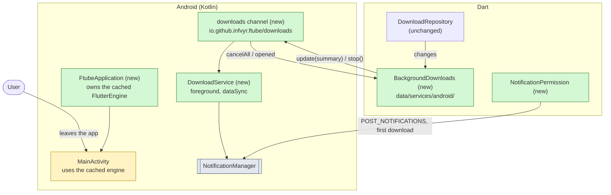
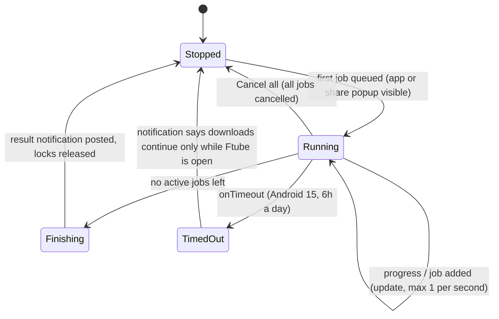
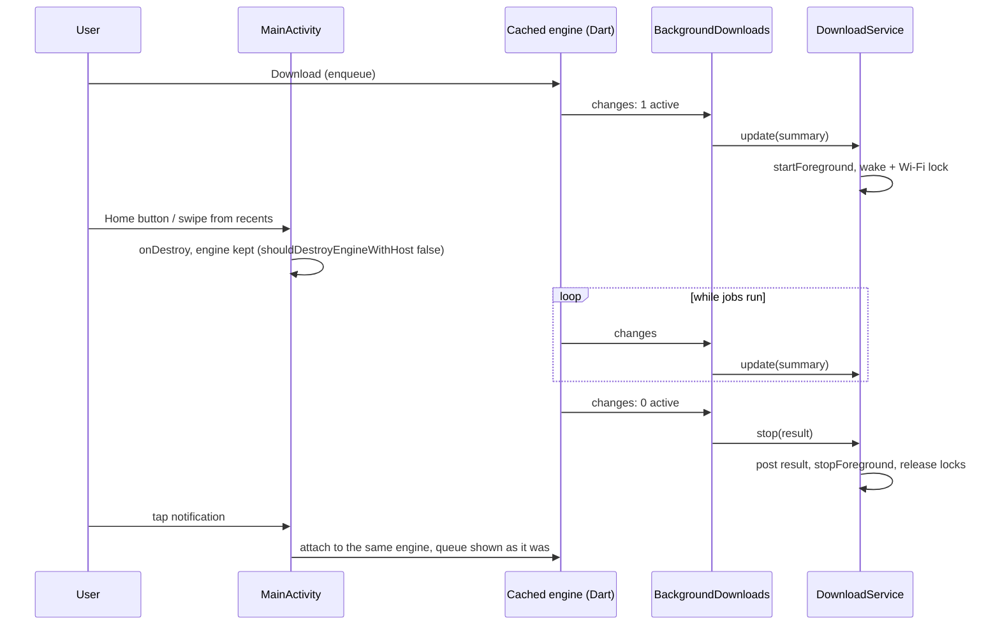

# Ftube Downloader v0.4 - Background downloads on Android (part 1 of 2)

Builds on [spec-v0.3.md](spec-v0.3.md). Decision, DoD and risk IDs continue its numbering. Release v0.4 is this spec plus [spec-v0.4-share.md](spec-v0.4-share.md) (share popup), built in that order: the popup runs on the cached engine and relies on the service from this spec. Lifts the "background downloads on Android" non-goal from [spec.md](spec.md) section 9 and [spec-v0.3.md](spec-v0.3.md) section 7. Persisting the queue across restarts stays a non-goal.

## Summary

- **Problem:** the queue lives in Dart, inside the activity's Flutter engine. When the user leaves Ftube during a download, Android can kill the process, and with it yt-dlp and the queue. The screen turning off can also pause the CPU. Closing the activity (Back on Home, swiping from recents) destroys the engine at once.
- **Fix:** keep the process and the engine alive while jobs run.
  - A Kotlin `DownloadService` runs as a `dataSync` foreground service whenever the queue has active jobs. It holds a partial wake lock and a Wi-Fi lock, and shows one ongoing progress notification.
  - The Flutter engine moves to a cached engine owned by a new `FtubeApplication`, so it outlives the activity. Download logic stays in Dart, unchanged. The share popup in part 2 attaches to the same engine.
  - Dart drives the service through a new `io.github.infvyr.ftube/downloads` channel, from `DownloadRepository.changes`.
- **User-visible:** a "Downloading 2 of 5 - 43%" notification with Cancel all, and a "5 downloads finished" (or "1 failed") notification at the end. Tapping either opens Home.
- **Main risks:** Android 15 caps `dataSync` services at 6 hours a day (R-22), and some vendors (Xiaomi, Samsung) kill foreground services anyway (R-23).

## 1. What changes

**Which parts change**

## 2. Service lifecycle

**When the foreground service runs**

- The service starts from `enqueue`, when the app or the share popup is in the foreground, which Android 12+ requires for starting a foreground service.
- One service and one notification for the whole queue, however many jobs there are.
- Notification updates are throttled to one a second. yt-dlp prints several progress lines a second, and Android rate-limits notification updates.

**How a job keeps running after the user leaves**

## 3. Decisions

- D-40: the queue stays in Dart, and the service only keeps the process alive - moving downloads into Kotlin would duplicate `DownloadRepository`, `AndroidMediaService`, muxing and naming. The price is that the engine must outlive the activity (D-41).
- D-41: `FtubeApplication` creates one `FlutterEngine`, runs `main`, and caches it under `ftube`. `MainActivity` uses it (`getCachedEngineId`) and doesn't destroy it on `onDestroy`. Plugins that need an activity (permission_handler, file_selector) attach and detach with it as before. The engine is created when the process starts, so a share popup started cold (part 2) finds it ready. `configureFlutterEngine` runs on every attach, so each activity that attaches (MainActivity, later ShareActivity) re-registers the channels that need it, such as trash and files, and the last one to attach handles them.
- D-42: foreground service type `dataSync` - it fits downloads and needs no Play review (Ftube isn't on Play anyway). Needs `FOREGROUND_SERVICE` and `FOREGROUND_SERVICE_DATA_SYNC`. `onTimeout` is handled (state diagram).
- D-43: a `PARTIAL_WAKE_LOCK` and a `WIFI_MODE_FULL_HIGH_PERF` Wi-Fi lock are held only while the service runs, so a download doesn't stall with the screen off. Needs `WAKE_LOCK`.
- D-44: `POST_NOTIFICATIONS` (Android 13+) is asked on the first download, not at launch. If it's denied, downloads still run in the background; Android just hides the notification and shows the app in the Task Manager instead.
- D-45: the channel contract:

  | Direction | Method | Args | Notes |
  |---|---|---|---|
  | Dart → Kotlin | `update` | `{active: int, done: int, total: int, percent: int?, title: String?}` | starts the service if stopped |
  | Dart → Kotlin | `stop` | `{completed: int, failed: int}` | posts the result notification unless both are 0 |
  | Kotlin → Dart | `cancelAll` | - | from the notification action |

- D-46: `BackgroundDownloads` derives the summary from `DownloadRepository.changes`: `total` counts the jobs since the service started, and `percent` is the mean progress of running jobs. `cancelAll` calls `DownloadRepository.cancel` for every active job.
- D-47: two notification channels: "Downloads in progress" (low importance, silent) and "Finished downloads" (default importance). The names come from the app's ARB files, in all six languages.
- D-48: desktop doesn't change. The desktop app keeps running while minimized, and closing the window still stops downloads, as in v0.1.

## 4. Testing

| Level | Covers | Tools |
|---|---|---|
| Unit | `BackgroundDownloads`: update on first active job, throttled updates, `stop` with counts, `cancelAll` cancels only active jobs, nothing on desktop | fake `DownloadRepository` stream, mock channel, `fakeAsync` |
| Unit | Summary math: mean percent, `total` reset after stop | `test` |
| Widget | First download asks for notification permission once; denial still queues the job | mock permission service |
| Manual | Home button, swipe from recents, Back on Home, screen off 10 min, airplane mode mid-download, Cancel all from the notification | Android 12 device, latest emulator |

## 5. Definition of Done

- DoD-25: A 1GB download started in Ftube completes with the screen off and the app in the background, on the Android 12 device.
- DoD-26: Swiping Ftube from recents during a download doesn't stop it; reopening shows the same queue with live progress.
- DoD-27: The notification shows the count and progress, Cancel all cancels every active job, and the result notification counts completed and failed jobs.
- DoD-28: With notifications denied, downloads still finish in the background.
- DoD-29: When the last job ends, the service stops and releases its locks, and no Ftube notification stays ongoing.
- DoD-30: DoD-3 still holds: analyze and format are clean, all tests pass and the coverage gate is met.

## 6. Risks

- R-22: Android 15 limits `dataSync` foreground services to 6 hours in 24. Downloads that run longer continue only while Ftube is visible. If that matters, the alternative is a user-initiated data transfer job (Android 14+), which means moving work into a `JobService`.
- R-23: Some vendors (Xiaomi, Huawei, Samsung with "deep sleep") kill foreground services anyway. The README will point to dontkillmyapp.com; the app doesn't ask for battery-optimization exemption.
- R-24: A cached engine changes plugin lifetimes. Plugins that keep an activity reference (permission_handler, file_selector, the trash flow in `MainActivity`) must survive detach and reattach; check each after a swipe from recents.
- R-25: The wake and Wi-Fi locks drain battery if they leak. They're released in `stop`, in `onTimeout` and in `onDestroy`.

## 7. Non-goals (v0.4)

- Keeping the queue across a process kill, a reboot or an app update.
- Per-job notifications or pause and resume.
- Background downloads on desktop after the window closes, or running in the tray.
