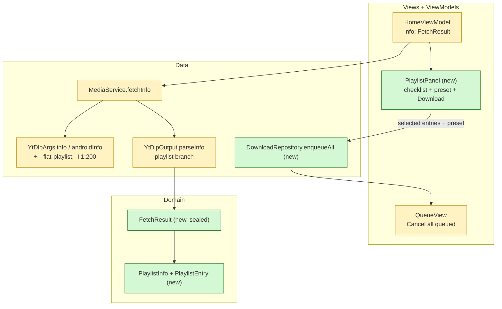
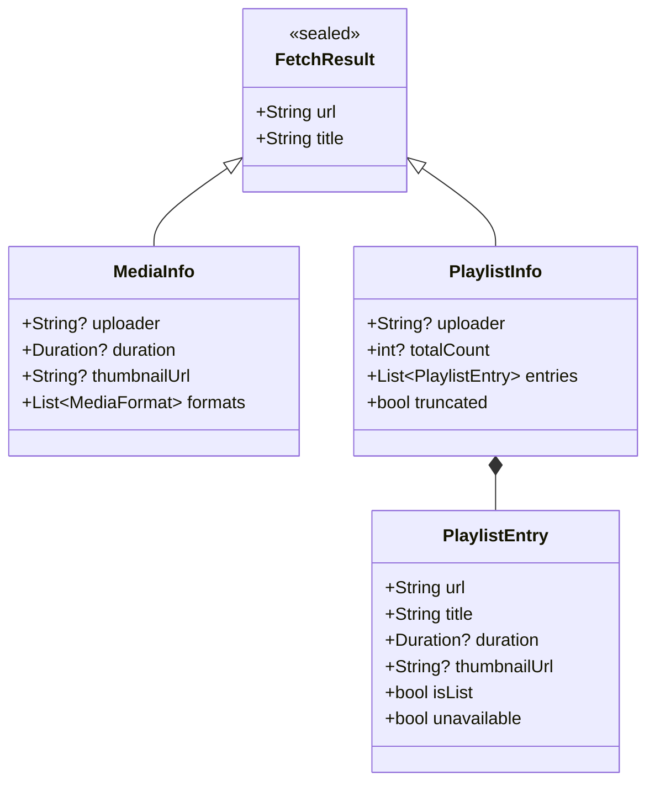
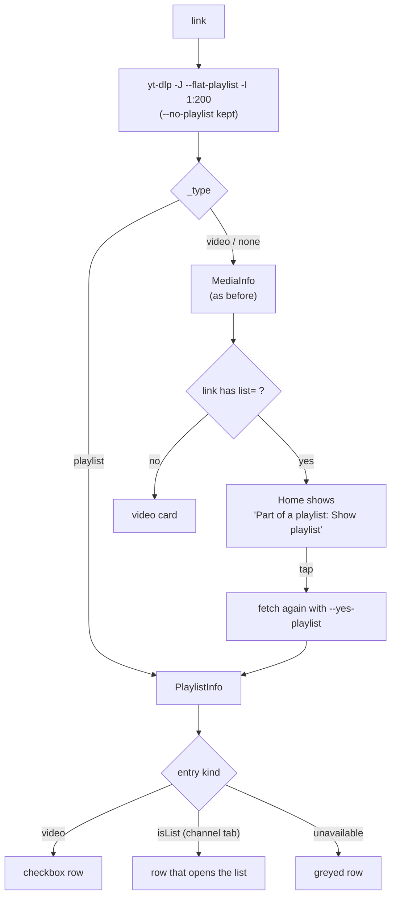
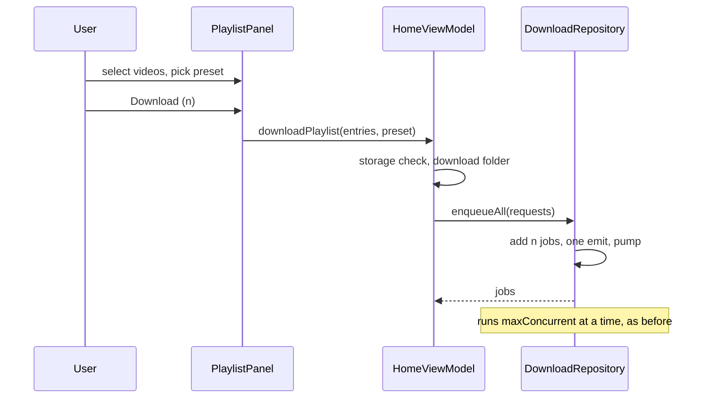
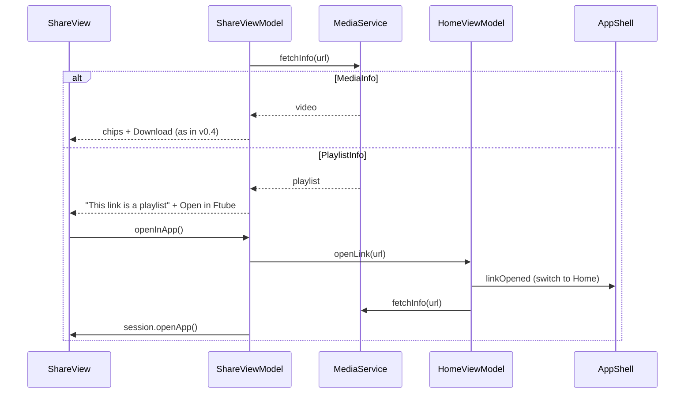
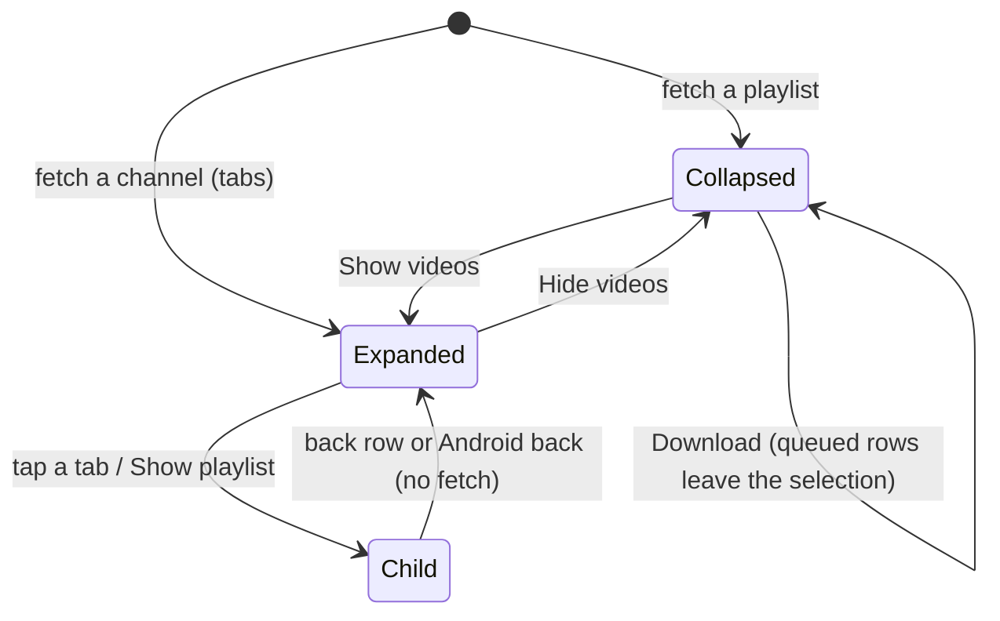
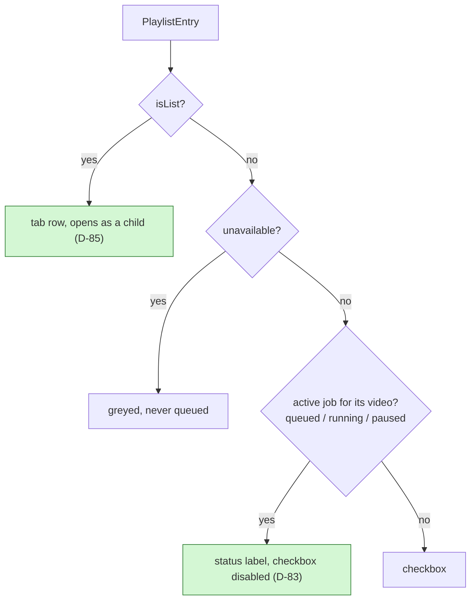

# Ftube Downloader v0.5 - Playlists and channels

Builds on release v0.4: [spec-v0.4.md](spec-v0.4.md) and [spec-v0.4-share.md](spec-v0.4-share.md). Decision, DoD and risk IDs continue the numbering of spec-v0.4-share.md. Lifts the "playlist and channel downloads" non-goal from [spec.md](spec.md) section 9.

## Summary

- **What:** a playlist or channel link shows its videos on Home as a checklist. The user picks videos and one quality preset, and Ftube queues one job per video. This works on every platform and every site where yt-dlp supports playlists.
- **Today:** every yt-dlp call passes `--no-playlist`, and `YtDlpOutput.parseInfo` throws `Unsupported('playlists are not supported')` on `_type: playlist`.
- **How:**
  - `fetchInfo` adds `--flat-playlist`, so a playlist comes back as a fast list of entries with no per-video lookup.
  - `MediaService.fetchInfo` returns a sealed `FetchResult`: `MediaInfo` for a video, `PlaylistInfo` for a list.
  - Home shows a `PlaylistPanel`. The download path, the queue, the repository and naming stay the same: N videos become N ordinary jobs.
- **Main risks:** large channels (R-28), and many queued jobs at once with v0.4 background downloads (R-29).

## 1. What changes

**Which parts change**

## 2. Data model

**What a fetch returns**

- `isList`: the entry is itself a playlist. A YouTube channel returns its Videos, Shorts and Live tabs this way. Tapping such an entry fetches it like a new link.
- `unavailable`: private or deleted videos, which yt-dlp lists with the title `[Private video]` or `[Deleted video]` and no duration. They're shown greyed out and can't be selected.
- `truncated`: more than 200 entries exist (`totalCount` from `playlist_count`).

## 3. Flows

**How a link becomes a video or a playlist**

- `--no-playlist` stays on, so a `watch?v=X&list=Y` link still opens the video, as today. The playlist is one tap away.
- `-I 1:200` caps the first fetch. The panel then says "Showing 200 of 1,240".

**Queueing a playlist**

## 4. Decisions

- D-55: `--flat-playlist` for every info call - a playlist then costs one request instead of one per video. Formats aren't known per entry, so a playlist download offers only the presets (Best, 1080p, 720p, 480p, MP3, OGG), not "All formats".
- D-56: the first 200 entries only (`-I 1:200`) - a large channel's full flat JSON takes long and isn't useful on a phone screen. "Load more" is a non-goal; the user can paste a narrower link (a playlist or a channel tab).
- D-57: all available entries are selected by default, with Select all / Select none.
- D-58: each entry becomes an ordinary job with the entry's URL and title, so retry, cancel, naming (D-39) and the Library work unchanged. `enqueueAll` adds them with one `changes` event instead of n.
- D-59: files go flat into the download folder, not a per-playlist subfolder - the Library lists only the top level of that folder (`FileSystemService.list`), and recursive listing is a separate change. A name clash between two entries gets ` (2)` (D-39).
- D-60: no numbering prefix ("01 - ") - titles stay as they are. A playlist index option is an open question.
- D-61: the queue gets "Cancel all queued", since a playlist can add 200 jobs at once. Running jobs keep their own Cancel.
- D-62: `YtDlpOutput.parseInfo` returns `FetchResult`, and the `Unsupported('playlists are not supported')` error is removed. A playlist with no entries is `Unsupported('empty playlist')`.

## 5. Testing

| Level | Covers | Tools |
|---|---|---|
| Unit | `parseInfo` playlist branch: flat entries, channel tabs (`isList`), private/deleted (`unavailable`), `truncated` from `playlist_count`, empty playlist | yt-dlp JSON fixtures from YouTube, Vimeo and SoundCloud |
| Unit | `YtDlpArgs.info` / `androidInfo`: `--flat-playlist`, `-I 1:200`, `--yes-playlist` variant | `test` |
| Unit | `DownloadRepository.enqueueAll`: n jobs, one emit, concurrency kept, "Cancel all queued" leaves running jobs | fake `MediaService` |
| Unit | `HomeViewModel.downloadPlaylist`: storage blocked, no folder, preset only, selection | `ProviderContainer` |
| Widget | `PlaylistPanel`: select all/none, greyed rows, "Showing 200 of N", channel tab opens a fetch, Download count | `flutter_test` |
| Manual | A 50-video YouTube playlist as MP3, a channel's Videos tab, a SoundCloud set, a `watch&list=` link | desktop and Android |

## 6. Definition of Done

- DoD-36: A YouTube playlist link shows its videos within the time a single video fetch takes plus 5s, and downloading 10 of them as MP3 gives 10 files named by title.
- DoD-37: A `watch?v=…&list=…` link opens the video, and "Show playlist" opens the list.
- DoD-38: A channel link shows its tabs, and opening the Videos tab lists the newest 200 videos with "Showing 200 of N".
- DoD-39: Private and deleted entries are greyed out and never queued. "Cancel all queued" cancels only queued jobs.
- DoD-40: Single-video links behave exactly as in v0.4.
- DoD-41: DoD-3 still holds: analyze and format are clean, all tests pass and the coverage gate is met.

## 7. Risks

- R-28: Big channels and some sites return slow or partial flat lists. The 200 cap and the watchdog (60s without output, spec-v0.3) bound the wait.
- R-29: Queuing 200 jobs fetches the same site 200 times in a row. YouTube may rate-limit (HTTP 429). The concurrency limit (1-3) stays the throttle; failed jobs can be retried.
- R-30: Flat entries on some sites have only an id and no title. The row then shows the URL, and the file name comes from the real title at download time (D-39).

## 8. Open questions

- Prefix files with the playlist index ("03 - Title") as an option, for albums and courses?
- Put each playlist in its own subfolder once the Library lists subfolders?

## 9. Non-goals (v0.5)

- "Load more" past 200 entries, and searching inside a playlist.
- Per-video quality or format choice inside a playlist.
- Watching a playlist or channel for new videos.

## 10. Changes from v0.4 (share popup, presets, update wait)

v0.4 added the share popup, the 360p and M4A presets and the info fetch that doesn't wait for the yt-dlp update ([spec-v0.4-share.md](spec-v0.4-share.md) section 10). This section adapts v0.5 to them.

**A playlist link shared into the popup**

- D-77: playlist downloads offer every Home chip: Best, 1080p, 720p, 480p, 360p, MP3, M4A, OGG. This replaces the list in D-55. Formats aren't known per entry, so the chips aren't pruned as in the popup (D-73).
- D-78: Home's single-video chips get 360p and M4A too, so Home, the popup and playlists offer the same presets.
- D-79: a playlist or channel link in the share popup shows "This link is a playlist" and "Open in Ftube". That opens the app on Home with the link, fetched as a playlist. A `watch?v=…&list=…` link still opens the video in the popup (`--no-playlist`, D-55).
- D-80: playlist fetches, including the `--yes-playlist` one, go through `fetchInfo`, so they don't wait for the yt-dlp update either (D-75).
- D-81: a YouTube channel tab has no `playlist_count`, so with an unknown count and a full page of 200 entries the panel says "Showing the first 200" and hides the total. This amends DoD-38.
- D-82: the share popup knows a YouTube playlist or channel link from the URL alone (`/playlist?list=`, `/@handle`, `/channel/`, `/c/`, `/user/`) and shows the playlist message at once without a fetch. Otherwise its Download, active from the start (D-65), would queue the whole link as one job before the slow playlist fetch ends. Other sites' playlists are still found by the fetch.

**Definition of Done**

- DoD-48: Sharing a playlist link shows the playlist message; "Open in Ftube" shows its videos on Home.
- DoD-49: Home and the playlist panel offer 360p and M4A.

**Risks**

- R-34: a preset that an entry lacks (360p for a video that starts at 480p, M4A on a site without it) fails or falls back per entry. M4A falls back to the best audio; a height chip fails that job, which can be retried with another preset.

## 11. Changes from the first v0.5 device test

**Home's playlist screen after the changes**

**What a row shows**

- D-83: a video that has a queued, running or paused job can't be queued again. Playlist rows show that status with the checkbox disabled, a playlist Download skips them and the queued entries leave the selection, so the button turns off by itself. Home's single-video Download is off while that video is active. Videos match by YouTube id when there is one (`youtu.be/x` = `watch?v=x`), else by link. A finished, failed or cancelled video can be queued again on purpose.
- D-84: the video list is collapsible. A playlist opens collapsed, with every available video selected, so Download works at once; the header shows title, count, "N selected" and Show/Hide videos. Select all/none show only while expanded. A channel opens expanded, since its rows are tabs to pick from.
- D-85: opening a channel tab or "Show playlist" keeps the previous screen (link, result, selection, open state) on a back stack. A "← <title>" row above the title and Android back on Home return to it without a fetch. A link typed, pasted, or opened from the share popup clears the stack.
- D-86: the queue gets "Clear all", shown whenever it has jobs. It cancels every queued, running and paused job, then removes all rows; downloaded files stay. It asks first when something is still queued, running or paused.

**Definition of Done**

- DoD-50: Tapping a playlist's Download twice queues each video once; active rows show their status.
- DoD-51: A playlist opens collapsed and can be downloaded without expanding it; Show/Hide videos toggles the list.
- DoD-52: From a channel, opening Videos and then going back (row or Android back) shows the channel tabs again at once.
- DoD-53: "Clear all" empties the queue after confirmation, leaving finished files in place.

**Risks**

- R-35: the back stack keeps full playlists (up to 200 entries each) in memory; it is cleared by any fresh link, so depth stays small in practice.
