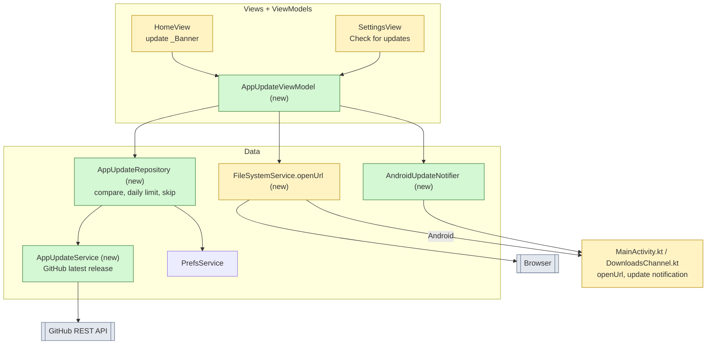
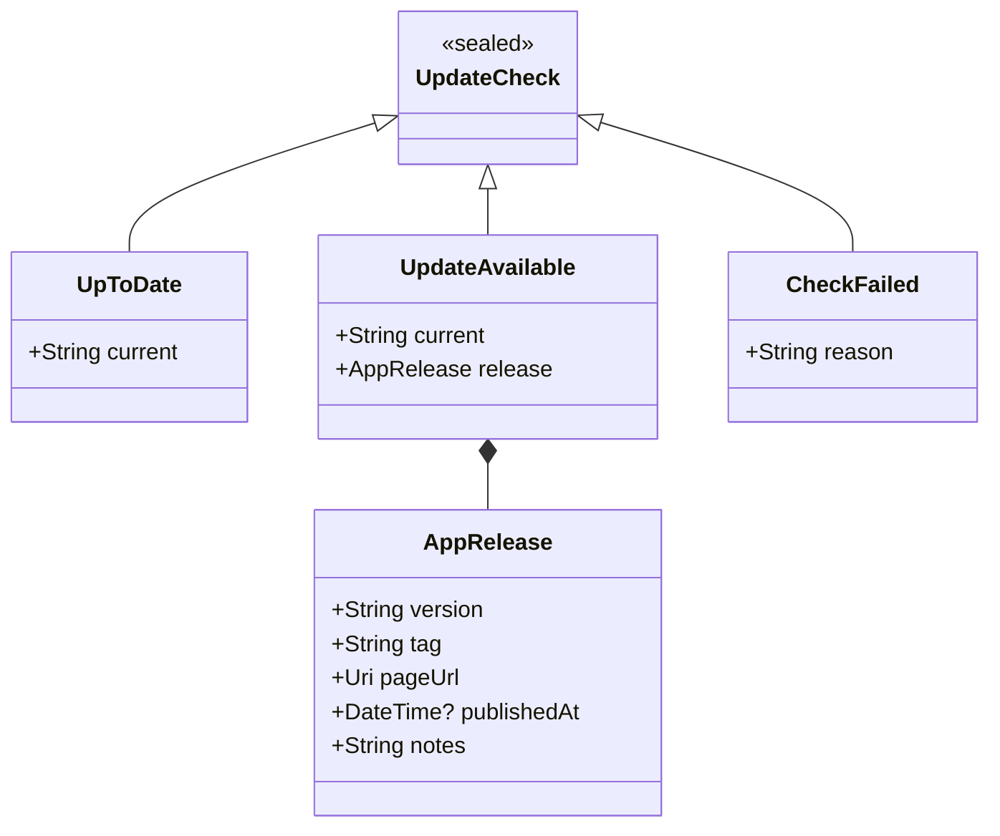
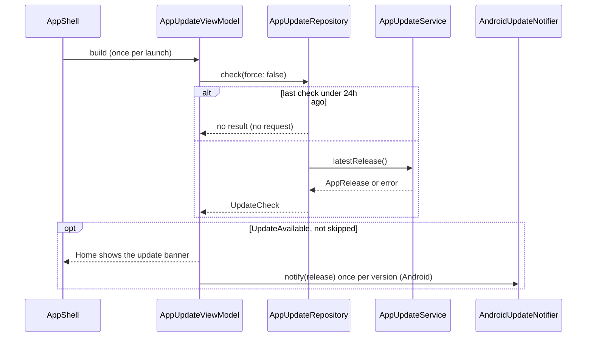
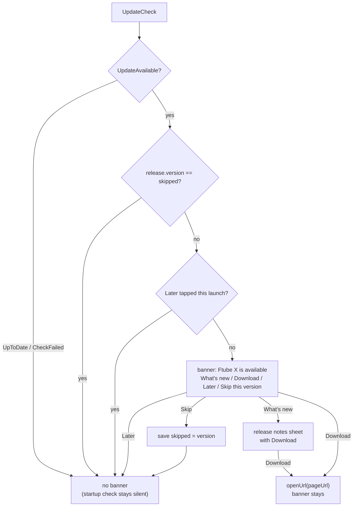

# Ftube Downloader v0.6

Builds on release v0.5: [spec-v0.5.md](spec-v0.5.md). Decision, DoD and risk IDs continue its numbering. Each v0.6 feature has its own numbered part below; more features will be added as further parts.

## Summary

- **Part A - update notice:** Ftube checks GitHub Releases for a newer version and tells the user. **Download** opens that version's release page in the browser, and the user installs it by hand as today (README). This works the same way on macOS, Windows, Linux and Android. Ftube is not in the Play Store and doesn't install updates itself.
- **How:** an `AppUpdateService` reads `GET /repos/vasile-novatchii/ftube/releases/latest` with the existing `HttpClient`. An `AppUpdateRepository` compares the tag with `PackageInfo.version`, limits checks to one a day and remembers a skipped version. Home shows the existing `_Banner` with What's new (release notes) / Download / Later / Skip, and Settings gets "Check for updates". Android also posts one system notification per new version.
- **Release side:** the `Release` workflow fails instead of signing the APK with a throwaway debug key, so an APK from the release page always installs over the old one.
- **Main risks:** the unauthenticated GitHub API limit of 60 requests per hour per IP (R-36), and opening a URL from the desktop without a new package (R-37).

## A1. What changes

**Which parts change**

- `appVersionProvider` (`lib/config/providers.dart`) already reads `PackageInfo.version`; the repository reuses it.
- The name `AppUpdate` keeps it apart from the yt-dlp `UpdateStatus` in Settings.

## A2. Data model

**What a check returns**

| JSON field (`releases/latest`) | `AppRelease` |
|---|---|
| `tag_name` (`v0.6.0`) | `tag`; `version` = tag without the leading `v` |
| `html_url` | `pageUrl` (`https://github.com/vasile-novatchii/ftube/releases/tag/v0.6.0`) |
| `published_at` | `publishedAt` |
| `body` (Markdown) | `notes`, as plain text (D-97) |

| Pref key | Value |
|---|---|
| `appUpdate.lastCheck` | epoch ms of the last successful check |
| `appUpdate.skipped` | version the user skipped, e.g. `0.6.0` |
| `appUpdate.notified` | version Android already posted a notification for |

## A3. Flows

**The check at startup**

**Whether the banner shows**

## A4. Decisions

- D-87: no in-app install - Download opens the release page, and the user picks the file and installs it as the README says. Self-install (Android `PackageInstaller`, a desktop helper that replaces the app) is a later phase, see the non-goals.
- D-88: the GitHub REST API `releases/latest` endpoint, no login - it returns the newest release that is not a draft or prerelease, so neither a prerelease tag nor the binaries pre-release in `assets/binaries/catalog.json` ever triggers the notice. Requests send `Accept: application/vnd.github+json` and `User-Agent: Ftube/<version>`, with a 10s timeout.
- D-89: one automatic check per 24h, run in the background after startup so it never delays the UI. `lastCheck` is saved only after a successful check, so an offline start tries again on the next launch.
- D-90: versions compare as `major.minor.patch` integers. A tag that doesn't parse, or a pubspec build suffix (`+5`), is ignored; an unparseable tag counts as "no update".
- D-91: the notice is the existing Home `_Banner`, not a dialog - it doesn't block a paste or a download in progress. Later hides it until the next launch; Skip hides it until a newer version appears.
- D-92: Settings shows "Check for updates" below App version. It ignores the 24h limit and the skipped version and shows its result in the tile subtitle: "Up to date", "Version X is available" with Download, or "Couldn't check for updates".
- D-93: Android posts one notification per new version on a new `app_update` channel, from the startup check only; the manual Settings check never posts one, since the user is already looking at the result. Tapping it opens the release page. Without the notification permission it is skipped silently; the banner still shows. There is no background check while Ftube is closed.
- D-94: `FileSystemService.openUrl(Uri)` opens the page: `open` on macOS, `rundll32 url.dll,FileProtocolHandler` on Windows (no `cmd /c start`, so the URL is never parsed by a shell), `xdg-open` on Linux, and a new `openUrl` method on the `io.github.infvyr.ftube/files` channel (`ACTION_VIEW`) on Android. No new package (`url_launcher`) is added.
- D-95: the `Release` workflow fails when `FTUBE_KEYSTORE_BASE64` is missing, instead of signing with a throwaway debug key. An APK signed with another key can't install over the old one, so a debug-signed release would break updating for every Android user.
- D-96: the README gets an "Updating" section per OS: Android installs over the old app and keeps its data; macOS replaces `Ftube.app` and repeats the `xattr` step; Windows and Linux replace the unpacked folder.
- D-97: release notes - the banner and the Settings result get "What's new", which opens a scrollable sheet with the version, date, notes and Download. The release `body` is Markdown; it is shown as selectable plain text with headings markers, `**`, backticks and `[text](url)` link syntax reduced to their text, so no Markdown package is added. An empty body shows "No release notes".

## A5. Testing

| Level | Covers | Tools |
|---|---|---|
| Unit | `AppUpdateService`: parses `tag_name` / `html_url` / `published_at`; 403, 404, 429, timeout and bad JSON become `CheckFailed` | fake `HttpClient`, JSON fixture from a real release |
| Unit | notes to plain text (D-97): headings, bold, code, links, `--generate-notes` output, empty body | `test` |
| Unit | version compare (D-90): `0.10.0 > 0.9.9`, equal, `v` prefix, build suffix, unparseable tag | `test` |
| Unit | `AppUpdateRepository`: 24h limit, force bypass, `lastCheck` only on success, skipped version, notify once per version | fake service, in-memory `PrefsService` |
| Widget | Home banner: Download / Later / Skip, hidden when skipped; Settings tile states | `flutter_test`, `ProviderContainer` overrides |
| Manual | an older build against the live `latest` release on each OS: banner, Download opens the page, Android notification, Settings check offline | desktop and Android release builds |

## A6. Definition of Done

- DoD-54: An older build starts, and within a few seconds Home shows "Ftube X is available"; Download opens the release page of version X in the default browser on macOS, Windows, Linux and Android.
- DoD-55: Later hides the banner until the next launch; Skip hides it until a newer version is published.
- DoD-56: A second launch within 24h sends no request; Settings' "Check for updates" always sends one and shows its result, including "Couldn't check for updates" offline.
- DoD-57: On Android, a new version posts one notification; tapping it opens the release page. A second launch, or a manual Settings check, posts no second notification.
- DoD-61: "What's new" in the banner and in Settings shows the release notes of version X as readable text, without raw Markdown markers.
- DoD-58: Offline or rate-limited starts show nothing and log the error.
- DoD-59: The `Release` workflow fails without the keystore secret, and the README has the "Updating" steps.
- DoD-60: DoD-3 still holds: analyze and format are clean, all tests pass and the coverage gate is met. New strings exist in every ARB file (en, ar, de, es, ro, ru).

## A7. Risks

- R-36: GitHub allows 60 unauthenticated requests per hour per IP. Shared IPs (offices, CGNAT on mobile) may hit it; the 24h limit keeps Ftube's share tiny, and a 403/429 is a silent `CheckFailed` (DoD-58).
- R-37: opening a URL on Windows without `url_launcher` - `rundll32 url.dll,FileProtocolHandler` is the plan; verify it on Windows 10 and 11, and fall back to `url_launcher` if it fails.
- R-38: a release published before all its assets are uploaded would point users to a page with missing files. The `publish` job creates the release only after every build finishes, so this holds as long as releases are not created by hand.
- R-39: if the repo is renamed or made private, every check fails silently. The repo path is one constant in `AppUpdateService`.

## A8. Open questions

- None open for Part A.

## A9. Non-goals (v0.6 update notice)

- Downloading or installing the update inside Ftube (Android `PackageInstaller`, desktop self-replace), and silent updates.
- Checking for updates while Ftube is closed (WorkManager, launch agents).
- Prerelease or beta channels.
