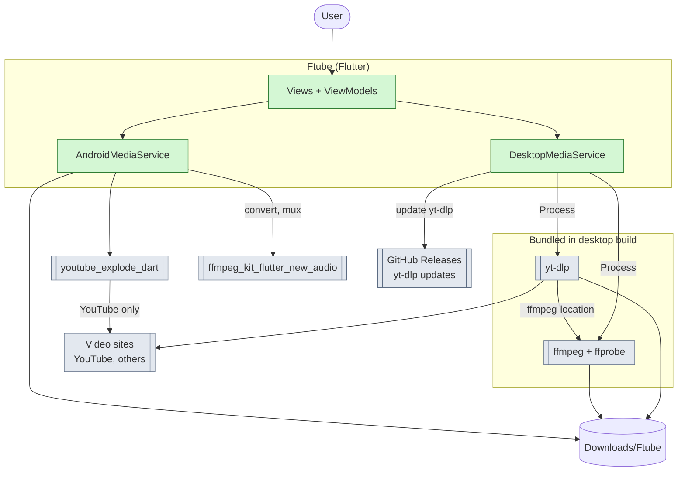
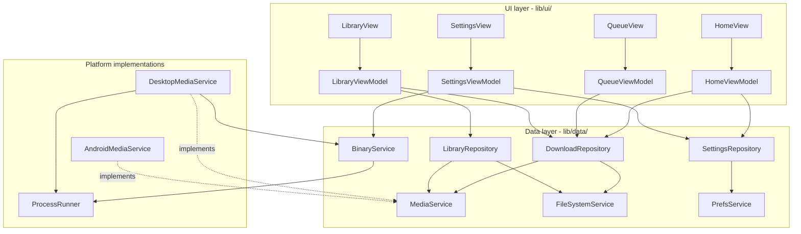
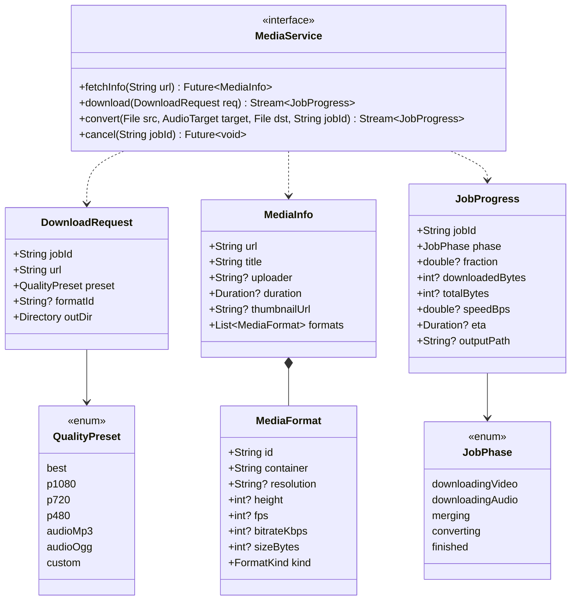
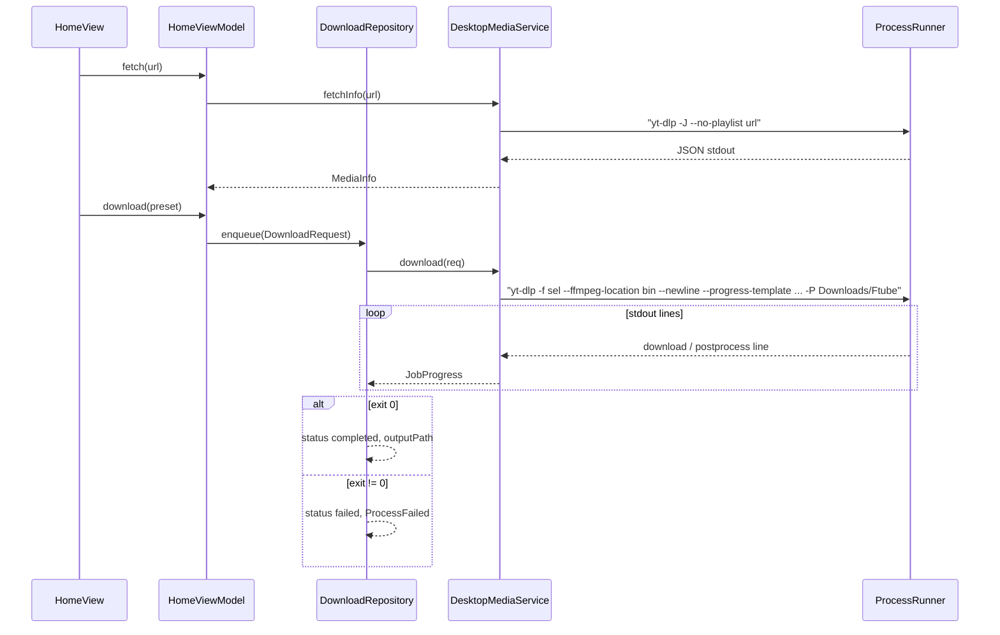
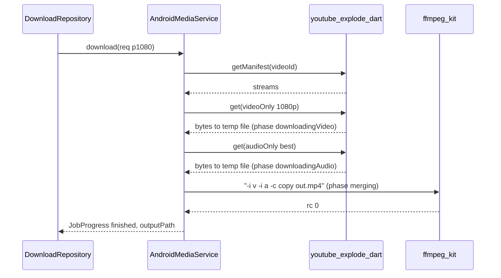
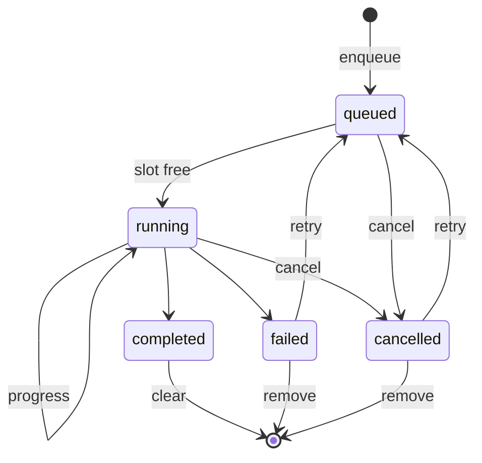
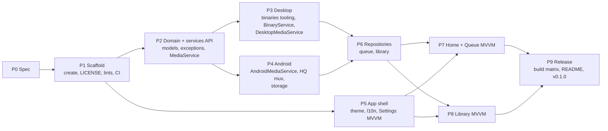

# Ftube - Specification

## Summary

- Ftube is a cross-platform Flutter port of `ftube.sh` from `vasile-novatchii/Linux-Features`. It fetches media info, downloads in any quality, extracts audio, converts media, and manages the downloaded files.
- Targets: macOS, Windows, Linux and Android. iOS and F-Droid are out of scope, and distribution is GitHub Releases only.
- Desktop ships bundled `yt-dlp` and `ffmpeg`/`ffprobe` binaries, so the user installs nothing.
- Android uses `youtube_explode_dart` for downloads and `ffmpeg_kit_flutter_new_audio` for conversion and for muxing high-quality video and audio streams.
- Both platforms sit behind one `MediaService` interface. The app follows MVVM as in the Flutter architecture guide: Views, ViewModels (Riverpod notifiers), Repositories and Services.
- Stack: latest stable Flutter (3.47.9), Riverpod 3, `gen-l10n` (EN default, RO), Material 3 with Light, Dark and System themes (System is the default), GPL-3.0, package ID `io.github.infvyr.ftube`. Minimum OS: Android 12 and macOS 12.0.
- Downloads go to `Downloads/Ftube` on every platform.
- Main risks: (1) YouTube changes break `youtube_explode_dart` on Android, (2) bundled universal binaries make the macOS `.app` large, and (3) Android needs the user to grant "All files access" for `Download/Ftube`.

## 1. Context

**What Ftube talks to on each platform**



- Desktop supports any site `yt-dlp` supports. Android supports YouTube only.
- `yt-dlp` needs `ffmpeg` and `ffprobe` to merge formats and to extract audio with `-x`. It finds them through `--ffmpeg-location`.

### Feature mapping from `ftube.sh`

| `ftube.sh` menu | Ftube | Desktop | Android |
|---|---|---|---|
| 0 Paste URL | URL field, paste button, clipboard URL detection | ✓ | ✓ |
| 1 List formats | Quality presets + "All formats" list | `yt-dlp -J` | `getManifest` |
| 2 Download format | Download the chosen preset or format, up to best quality | `yt-dlp -f` (merged by ffmpeg) | video-only + audio-only streams, muxed by ffmpeg_kit |
| 3 Extract MP3 | "Audio MP3" / "Audio OGG" presets | `yt-dlp -x` | audio stream, then ffmpeg_kit |
| 4 View files | Library screen | ✓ | ✓ |
| 5/6/7 Convert | "Convert to MP3/OGG" action on a library file | bundled ffmpeg | ffmpeg_kit |
| 8 Open with player | "Open" (system default app) | ✓ | ✓ |
| 9 Exit | - | - | - |

## 2. Architecture (MVVM)

**Layers, following the Flutter architecture guide**



- **Views** are widgets with no business logic. Each View has exactly one ViewModel.
- **ViewModels** are Riverpod `Notifier`/`AsyncNotifier` classes. Each exposes an immutable UI state (`freezed`) and command methods.
- **Repositories** are the source of truth and never call each other.
  - `DownloadRepository` owns the job queue.
  - `LibraryRepository` lists, deletes and converts files.
  - `SettingsRepository` holds the settings.
- **Services** are stateless wrappers:
  - `MediaService` covers yt-dlp/ffmpeg or the Android libraries.
  - `FileSystemService` handles listing, deleting, reveal and open.
  - `PrefsService` wraps `shared_preferences`.
  - `BinaryService` locates the bundled binaries, reports their versions and updates yt-dlp.
  - `StoragePermissionService` (Android) checks and requests storage access and resolves the public Downloads path.
- Domain models live in `lib/domain/models/`: `MediaInfo`, `MediaFormat`, `QualityPreset`, `DownloadJob`, `JobStatus`, `LibraryItem` and `AppSettings`.
- Providers are wired in `lib/config/providers.dart`. `mediaServiceProvider` chooses the implementation by platform, and tests override any provider with a fake.

**Service contract**



- Failures are typed `FtubeException` subclasses: `InvalidUrl`, `Unsupported`, `Network`, `BinaryMissing`, `ProcessFailed(exitCode, stderrTail)`, `StoragePermission` and `Cancelled`. ViewModels map each to a localized message.
- Desktop format selection: `best` = `bv*+ba/b`, `p1080` = `bv*[height<=1080]+ba/b[height<=1080]`, and so on for the other heights. `custom` uses the chosen `formatId`.
- Android format selection: the best video-only stream at or below the preset height, plus the best audio-only stream in a compatible container (mp4+m4a or webm+webm), muxed with `-c copy`.

## 3. Main flows

**Desktop high-quality download (bundled yt-dlp)**



- The flags `--restrict-filenames`, `--ignore-config` and `--no-playlist` are always passed, matching `ftube.sh`.
- QueueView and LibraryView observe the same `DownloadRepository` stream.

**Android high-quality download**



- Temp files are deleted on success, failure and cancel.
- Progress across the phases is weighted: video 0-80%, audio 80-95%, merge 95-100%.

**Download job lifecycle**



- Up to N jobs run at once, where N comes from Settings (1-3, default 2).
- The queue is held in memory. Jobs still running when the app quits are lost in v1.
- Library files are the persistent record of what was downloaded.

## 4. UI

**Navigation: NavigationBar on Android, NavigationRail on desktop**

```figure
┌────────────────────────────────────────────────────────────┐
│ Ftube                                                      │
├────────────────────────────────────────────────────────────┤
│ [ https://youtu.be/...                      ] [Paste] [Go] │
│ ┌──────┐ Song title                                        │
│ │thumb │ Channel · 03:42                                   │
│ └──────┘                                                   │
│ Quality: (Best) (1080p) (720p) (480p) (MP3) (OGG) [All ▾]  │
│                                          [ Download ]      │
├────────────────────────────────────────────────────────────┤
│ Queue (2)                                    [Clear done]  │
│ Song title · 1080p        ███████░░░  68%  4.2MB/s  0:09 ✗ │
│ Other video · MP3         merging...                     ✗ │
│ Broken link               failed: network          [Retry] │
├────────────────────────────────────────────────────────────┤
│        Home          Library          Settings             │
└────────────────────────────────────────────────────────────┘
```

**Actions per screen**

| Screen | Actions |
|---|---|
| Home | Paste URL, auto-detect a URL on the clipboard (with a prompt), fetch info with thumbnail/title/duration, choose a quality preset or a specific format, download |
| Queue (on Home; also a badge) | Live progress (percent, phase, size, speed, ETA), cancel, retry, remove, clear finished, open the finished file |
| Library | List files in `Downloads/Ftube` with type icon, size and date; search; filter (Video / Audio); sort (date / name / size); open; reveal in folder (desktop) or share (Android); convert to MP3/OGG; rename; delete one; multi-select delete; delete all. Every delete asks for confirmation |
| Settings | Theme (System default / Light / Dark), language (English default / Română), download folder (default `Downloads/Ftube`, changeable, with a reset), default quality preset, concurrent downloads (1-3), yt-dlp version + "Update yt-dlp" (desktop), ffmpeg version, About (app version, GPL-3.0, third-party licenses for yt-dlp, FFmpeg and packages) |

- Android first run: a permission screen explains the need for "All files access" and opens the system setting. Settings shows the access status, with a button to grant it.
- Snackbars confirm actions. Delete actions offer Undo for 5 seconds before the file is removed.
- Empty states: no URL yet, empty queue, empty library.

## 5. Decisions

- D-1: Desktop bundles `yt-dlp` standalone binaries (`yt-dlp_macos`, `yt-dlp.exe`, `yt-dlp_linux`) plus static `ffmpeg`/`ffprobe` - the user installs nothing.
- D-2: Bundled binaries are pinned by version and SHA-256 in `tool/binaries.yaml`. `tool/fetch_binaries.dart` downloads them in CI and locally before a build, and they are never committed to git.
- D-3: Binaries are placed next to the executable: `Contents/MacOS` on macOS, the folder of `ftube.exe` on Windows, and `bundle/lib` on Linux. `BinaryService` resolves them from `Platform.resolvedExecutable`.
- D-4: "Update yt-dlp" runs `yt-dlp -U` against a copy in the app support folder. The bundled copy stays read-only as a fallback.
- D-5: Android uses `youtube_explode_dart` + `ffmpeg_kit_flutter_new_audio`. High quality comes from muxing a video-only and an audio-only stream with `-c copy`.
- D-6: The architecture is MVVM as in the Flutter guide, with Riverpod 3 notifiers as ViewModels, `riverpod_generator` and `freezed` for state.
- D-7: Theme uses `ThemeMode.system` by default, with a user override for Light or Dark. Material 3 with a seeded `ColorScheme`.
- D-8: Localization uses `gen-l10n` with ARB files: `app_en.arb` is the template and `app_ro.arb` the translation. English is the default and the fallback.
- D-9: Downloads go to `Downloads/Ftube` by default. Desktop uses `getDownloadsDirectory()` + `Ftube`. Android uses the public `Download/Ftube` folder, read and written with plain `dart:io` file paths (see D-13).
- D-13: Android storage access:
  - Request `MANAGE_EXTERNAL_STORAGE` ("All files access") through `permission_handler`. This gives full read, write and delete in `Download/Ftube`, including files left from a previous install or added by other apps. Google Play restricts this permission, but Ftube is not on Play.
  - Since `minSdk` is 31 (D-15), there is no legacy storage branch.
  - Resolve the public Downloads path through a small `MethodChannel` (`Environment.getExternalStoragePublicDirectory(DIRECTORY_DOWNLOADS)`). New files are announced to the gallery and media apps with `MediaScannerConnection.scanFile`.
  - A first-run permission screen explains why access is needed. If access is denied, downloads are blocked with a "Grant access" button.
- D-15: Minimum OS versions:
  - Android 12 (`minSdk 31`).
  - macOS 12.0, Flutter 3.47.9's template default (`MACOSX_DEPLOYMENT_TARGET`).
  - Windows and Linux use Flutter's defaults.
- D-14: macOS ships one universal `.app` for arm64 and x86_64. The bundled `yt-dlp_macos` must be universal, and `ffmpeg`/`ffprobe` are made universal by `lipo -create`-ing the arm64 and x86_64 static builds in `tool/fetch_binaries.dart`. CI verifies the result with `lipo -archs`.
- D-10: "Open with player" becomes "open with the system default app".
- D-11: The macOS App Sandbox is off and the network client entitlement is on, so the app can run its bundled binaries.
- D-12: Lints use `flutter_lints` plus strict-casts, strict-inference and strict-raw-types.

## 6. Testing

| Level | Covers | Tools |
|---|---|---|
| Unit | yt-dlp JSON and progress parsers, ffmpeg progress parser, format-selector builder, Android stream picker, phase weighting, exception mapping | `test`, fixtures in `test/fixtures/` |
| Unit | `DesktopMediaService` and `BinaryService` with a fake `ProcessRunner` (success, non-zero exit, missing binary, cancel, update) | `mocktail` |
| Unit | Repositories: queue concurrency, retry, cancel, library list/sort/filter, delete one/many/all, settings persistence | fakes for the services |
| ViewModel | State transitions per ViewModel, including the job lifecycle diagram | `ProviderContainer` + overrides |
| Widget | Every View in EN and RO and in Light and Dark; empty, loading and error states; delete confirmation and Undo | `flutter_test` |
| l10n | Every key in `app_en.arb` exists in `app_ro.arb` | unit test |
| Unit | `StoragePermissionService`: granted, denied and permanently denied, with the platform channel mocked | `TestDefaultBinaryMessenger` |
| Integration | Paste → download → library → delete with a fake service, on desktop and an Android emulator | `integration_test` |
| Manual | Android `Download/Ftube` on API 31 and on the latest API: grant and deny access, reinstall, then delete old files | `docs/release.md` checklist |
| Smoke | Real bundled binaries: `yt-dlp --version`, `ffmpeg -version` and one short download per OS | CI release job + `docs/release.md` checklist |

- Coverage gate: at least 85% line coverage for `lib/data/` and `lib/ui/**/view_model*`, enforced in CI.
- CI (GitHub Actions) runs analyze, format check and tests with coverage on every push and PR. Tags `v*` build macOS, Windows, Linux and Android and run the smoke test.

## 7. Phases (one clean commit per phase)



**Definition of Done**

- DoD-1: Every row of the feature mapping table works on macOS, Windows, Linux and Android, including high-quality downloads on Android.
- DoD-2: A fresh desktop install downloads and converts without the user installing yt-dlp or ffmpeg.
- DoD-3: Analyze and format are clean, all tests pass, and the coverage gate is met.
- DoD-4: The theme follows the OS on a fresh install, and the user can override it.
- DoD-5: The app is in English on a fresh install, and every string exists in both EN and RO.
- DoD-6: Files land in `Downloads/Ftube` by default, and single, multi-select and delete-all all work with confirmation. On Android this also covers files from a previous install or from other apps.
- DoD-10: macOS ships as one universal `.app`, and `lipo -archs` reports `x86_64 arm64` for the app binary, `yt-dlp`, `ffmpeg` and `ffprobe`.
- DoD-7: The queue shows live progress, cancel, retry and remove.
- DoD-8: A tag `v*` publishes macOS (.zip), Windows (.zip), Linux (.tar.gz) and Android (.apk) artifacts to a GitHub Release.
- DoD-9: The repo has a GPL-3.0 `LICENSE` and a third-party notices file. The README has install steps per OS, including the macOS quarantine note.

## 8. Constraints and risks

- R-1: Bundled binaries add tens of MB per desktop build. Accepted.
- R-2: Universal macOS binaries roughly double the size of the bundled ffmpeg. Accepted for a single `.app` (D-14). Verify in P3 that `yt-dlp_macos` is universal, and lipo it if not.
- R-3: "All files access" is a broad permission and users must grant it manually in system settings. If they refuse, Android downloads cannot run (D-13). Some OEM ROMs may behave differently, so P4 tests on an emulator at API 31 and on the latest API.
- R-4: `youtube_explode_dart` breaks when YouTube changes, and some clients need a JS challenge solver. Android downloads may fail until the package is updated.
- R-5: `ffmpeg_kit_flutter_new_audio` also declares desktop platforms, so desktop builds may include its libraries on top of the bundled CLI. Measure in P4 and exclude if possible.
- R-6: Android has no background downloads in v1. Downloads stop if the OS kills the app, and a foreground-service notification is planned for v2.
- R-7: Unsigned macOS and Windows builds trigger Gatekeeper and SmartScreen warnings. Bundled binaries inside a quarantined app may need the same `xattr` fix. Document it in the README.
- R-8: The bundled ffmpeg and the PyInstaller yt-dlp binaries contain GPL code. Ftube is GPL-3.0, so this is compatible, but the notices and source links must ship with each release.
- R-9: Bundled static ffmpeg builds and the ffmpeg_kit plugin may each require a newer macOS than 12.0. P3/P4 check their minimum versions, and D-15 is raised to match if needed.

## 9. Non-goals (v1)

- iOS, F-Droid, app store releases.
- Playlist and channel downloads.
- Background downloads on Android, or persisting the queue across restarts.
- A built-in media player.
